# jb-sdlc-plugin

A lean, gated, cost-aware AI SDLC for Claude Code that works in any git repo.
Unlike the other plugins in this marketplace, it doesn't depend on
`jb_gateway_mcp`.

```mermaid
%%{init: {"theme": "base", "themeVariables": {"fontFamily": "ui-sans-serif, system-ui", "lineColor": "#64748B"}}}%%
flowchart LR
    P(["implement X / fix bug / take task"]):::actor --> R["router hook"]:::changed
    R --> Z{"size it"}:::risk
    Z -- quick --> Q["chat plan, your yes"]:::external
    Z -- lite --> PL["plan + ACs"]:::new
    Z -- full --> SP["spec"]:::new --> PL
    PL -- "you approve" --> B["build on Sonnet<br/>parallel lanes"]:::new
    B -- "tests green" --> RV["review<br/>Verdict: PASS"]:::test
    RV --> SH["ship: local commit"]:::new
    SH -- "you push + open PR" --> U(["you"]):::actor
    classDef new fill:#DCFCE7,stroke:#16A34A,color:#14532D,stroke-width:2px
    classDef changed fill:#DBEAFE,stroke:#2563EB,color:#1E3A8A,stroke-width:2px
    classDef external fill:#F3F4F6,stroke:#6B7280,color:#111827,stroke-dasharray:4 3
    classDef risk fill:#FEF3C7,stroke:#D97706,color:#78350F,stroke-width:2px
    classDef test fill:#F3E8FF,stroke:#9333EA,color:#581C87
    classDef actor fill:#FFE4E6,stroke:#E11D48,color:#881337,stroke-width:2px
```



## Components

| Component | Model / effort | Role |
|---|---|---|
| `sdlc` skill | session model | Orchestrator. Sizes the task (quick / lite / full), routes to the next phase and applies the cost rules. |
| `sdlc-spec` skill | session, `medium` | Writes the one-page spec with testable ACs (full track only). |
| `sdlc-plan` skill | session, **`high`** | Writes the plan: files, steps, AC→test map, verification commands. |
| `sdlc-build` skill | thin coordinator | Delegates to `sdlc-builder`, handles BLOCKED decisions with you, spot-checks the result and records evidence. |
| `sdlc-review` skill | thin coordinator | Runs `sdlc-reviewer` on every track, plus `code-review` (high) on the full track and `security-review` when relevant. |
| `sdlc-ship` skill | session, `low` | Branch check, version bump, `pr.md`, a final **local** commit, and the push and PR commands for you to run. |
| `sdlc-scout` agent | **haiku**, `low`, 30 turns, no CLAUDE.md | Read-only code locator, used instead of the built-in Explore (which runs on Opus). |
| `sdlc-builder` agent | **sonnet**, `medium` (`high` on full track), 120 turns | Test-first implementation in an isolated context. |
| `sdlc-reviewer` agent | **sonnet**, `high`, 40 turns | Fresh-context review against the ACs and plan, tests and private-data leaks. |
| `hooks/route.py` | UserPromptSubmit | Adds one context line pointing development prompts at `sdlc`, and announces the active feature and phase. |
| `hooks/lean.py` | PostToolUse | Flags output-token waste as it's written: comment-heavy edits, comments that narrate code, commented-out code, and whole-file Writes that changed only a little. It sends a one-line hint back and never blocks. |
| `hooks/session.py` | SessionStart | Routes this session's git through `githooks/` (via `CLAUDE_ENV_FILE`; no repo or global config changes). |
| `githooks/` | git hooks | `pre-push` refuses any push from a Claude session. `pre-commit` runs the fresh-branch check and refuses code commits before plan approval. `pre-merge-commit` refuses merges into the base, and `reference-transaction` refuses moving `main`/`master` anywhere except to `origin/<base>`, so `git pull` still works. All of them hand off to the repo's own hooks. |
| `hooks/drift.py` | PostToolUse (Bash) | Checks results, not command text: reports code files changed since the feature started while the plan is unapproved. |
| `hooks/gate.py` | PreToolUse | Blocks every `git push`, `gh pr create` and `gh pr merge`, and merges into the base. Blocks commits on main or merged branches, and edits to `state.json`. Blocks code changes before the plan is approved, whether made with the Edit/Write tools or through the shell. |
| `scripts/sdlc.py` | stdlib CLI | `new`, `track`, `status`, `approve`, `reopen`, `revert-drift`, `abandon`, `check-diagrams`, `check-branch`. |
| `references/diagrams.md` | — | Mermaid house style (muted, semantic palette that works in light and dark themes) and templates: user flow, change map, sequence, lanes, state, ER. |

## Cost model

These are API list prices per million tokens (input / output), from the
`claude-api` reference as of 2026-11-03:

| Model | $ in / out | Used for |
|---|---|---|
| `opus` | 4 / 20 | Sizing, spec, plan and coordination, when your session runs on `opus` (set in `settings.json`) |
| `sonnet` | 2 / 10 | Build (most tokens) and review |
| `haiku` | 0.10 / 0.50 | Code search for spec and plan |

The levers below are listed by impact. They follow Anthropic's Claude Code
cost guidance: Sonnet for most coding, Opus for architecture and reasoning,
Haiku for simple subagents, verbose work kept in subagents, and small
contexts.

1. **Right-size the ceremony.** Most work is quick or lite. Full-track
   overhead (separate spec, extra review passes) only applies where an error
   is expensive: money math, auth, migrations, packaging.
2. **Put bulk tokens on Sonnet.** The build phase, with its file reads,
   edits and test output, runs in `sdlc-builder` at half Opus's per-token
   price, in a fresh context. Only a short status block returns to the main
   session.
3. **Search on Haiku.** At these prices, `sdlc-scout` reads code at about
   1/40 of Opus's input cost and skips loading CLAUDE.md.
4. **Spend thinking on judgment, not typing.** The plan runs at `high`
   effort, while build and ship run at `medium` and `low`. Nothing uses
   `max` unless you ask.
5. **Keep the cache warm.** Each phase stays on one model; switching
   models drops the prompt cache, since it is per model. Separate models
   live in separate subagent contexts.
6. **Make resuming cheap.** State lives on disk and the router re-announces
   the phase, so `/clear` between features costs nothing.
7. **Don't generate what nobody reads.** Output tokens cost 5× input. Code comments carry only the non-obvious why, with no narration, banners or commented-out code. Edits are minimal diffs, not file rewrites. Chat replies don't echo code or tool output. Agents return fixed blocks. `lean.py` and the reviewer both check for this.
8. **Cap runaway work.** `maxTurns` limits every agent, and review fixes
   re-run only the reviewer, not the whole review stack.

## Parallelism

Parallel subagents cut wall-clock time, not tokens, so the kit fans out only
where jobs are independent:

| Phase | Runs concurrently |
|---|---|
| spec / plan | one `sdlc-scout` per code area |
| build | one `sdlc-builder` per **plan lane**, each in its own git worktree (`isolation: worktree`), merged in lane order, then one integration test run |
| review | `sdlc-reviewer` alongside `code-review` / `security-review` |
| several tasks | one worktree + feature branch + builder per task, with approvals batched into one question |

Lanes need disjoint file sets, and at most 3 run at once. A merge conflict
falls back to a sequential rebuild of that lane, never a hand-merge.
Sequential is the default.

To measure, `/usage` in Claude Code attributes your plan usage to skills,
subagents and plugins. The session model stays whatever
`~/.claude/settings.json` sets. If you'd rather Claude Code switch models
itself, `opusplan` (Opus in plan mode, Sonnet otherwise) is the built-in
equivalent. This plugin already routes per phase, so you don't need it.

## Artifacts

The full-track `spec.md` carries a user-flow diagram. `plan.md` carries a
change map on the full track, or when it touches 3 or more files or has
lanes, plus a sequence or ER diagram where relevant. `approve` refuses a
diagram that fails the lint. That lint is a built-in syntax check, plus a
full render with `mmdc` if it is installed.

```
docs/sdlc/2026-11-20-card-import/
  spec.md      full track only: problem, ACs, non-goals
  plan.md      (lite: goal + ACs +) files, steps, AC→test map, verification
  review.md    AC table, findings, Verdict
  pr.md        PR description for you to use when you push
  state.json   track, branch, base, approvals (written only by sdlc.py)
```

The phase is derived from the files, not stored. Approvals of
spec, plan and review are tied to the file's sha256, so editing an approved
file re-opens its gate and every gate after it.

## Rules the kit enforces

| Rule | How |
|---|---|
| **Never publishes** | The hook blocks `git push`, `gh pr create`, `gh pr merge`, and `git merge` while on `main`/`master`. The push and PR checks fail closed: they match anywhere in the command, including when git or gh is called by full path or quoted, after a prefix like `timeout`, `nice` or `sudo`, in `&` chains, and inside `bash -c '…'` or `$(…)`. Heredoc bodies such as commit messages are skipped, and a `-m` message that literally says `git push` is refused too. Ship ends with a local commit, a `pr.md`, and the commands for you to run. Merging plan lanes into the feature branch is still allowed. |
| **Every plan approved first** | **Lite and full:** code changes outside `docs/sdlc/` are blocked until you approve `plan.md`, whether made with Edit, Write, MultiEdit or NotebookEdit, or through shell writes (`>`, `tee`, `sed -i`, `cp`, `mv`, `rm`, `touch`, `patch`, `git apply`). **Quick:** a 2–4 line plan in chat needs your explicit yes; the skill requires this, since there are no files for a hook to check. Re-plans and review fix lists need approval too. |
| **Discussion, with evidence** | Spec and plan start with a discussion round: the evidence found, the approach and its alternative, and questions for you. `approve` refuses when a required section is empty, when `## Evidence` cites nothing that was actually read or run (`path:line` or a `` `command` ``), when `## Open questions` isn't `None`, or when `--note` doesn't carry your words. |
| **Approvals can't be forged** | Only `sdlc.py approve` writes `state.json`; the hook blocks edits to it. Approvals are tied to each file's sha256. Re-approving an edited spec or plan clears the build and review approvals after it, and dropping from full to lite needs `--note` with your words and re-opens the plan. |
| **Fresh branch** | Before judging, it runs `git fetch --prune` (at most once a minute) so a merge on GitHub is seen. Commits are blocked on `main`/`master`. They're also blocked on a branch whose upstream is `[gone]`, whose PR merged after the branch was created (checked with `gh`), or whose own commits, recorded in its reflog, are all in the base already. A branch that was just created and pushed counts as fresh. `new` runs `git pull --ff-only` on the base before branching. |

**Switches:**

| Switch | Effect |
|---|---|
| `SDLC_GATES=off` | Disables every gate. |
| `SDLC_ALLOW_PUSH=1` | Lets pushes and PRs through. Claude can't set it inline, but **you** can, for the hand-off: `! SDLC_ALLOW_PUSH=1 git push …`. Setting it before the session starts lets Claude push too. |
| `SDLC_AUTOROUTE=off` | Disables the router. |
| `SDLC_LEAN=off` | Disables the output-token watchdog. |
| `SDLC_NO_GH=1` | Skips the merged-PR lookup. |
| `SDLC_NO_FETCH=1` | Skips the pre-check `git fetch`, for offline use. |

If a hook hits an internal error, it allows the action. The commit/push gate
is different: it runs with `"onFailure": "block"` (needs Claude Code
v2.1.295 or later) and a 30-second limit. Its own network calls (`git fetch`,
`gh`) are capped at 4 seconds each, so a slow network can't time the gate out
and let a commit through. The gate needs `python3` on `PATH`. If it's
missing, every Bash and edit call is blocked until you disable the plugin.

**Threat model.** The gates protect against *mistakes*: a push, a commit on a
stale branch, or code written before you approved the plan. They don't
protect against a determined adversary; any process with shell access can
undo local controls. Enforcement works in layers, strongest first:

1. **Git hooks (`githooks/`).** Git runs these however a command is spelled:
   aliases, absolute paths, wrappers, `bash -c`, heredocs, `eval`. They're
   active only while `CLAUDECODE=1` is set, so your own terminal is
   unaffected. `--no-verify` and `core.hooksPath`/`GIT_CONFIG_*` overrides
   are refused by the text gate, as are inline `CLAUDECODE`/`SDLC_*` assignments and `env -i`/`env -u`.
2. **Results check (`drift.py`).** After every Bash command it compares
   `git status` against the baseline recorded by `sdlc.py new`. Claude is
   told about unapproved code changes and reverts its own with
   `sdlc.py revert-drift <paths>`, which only touches reported files. It
   asks you before reverting anything that could be your own edit. The
   pre-commit hook won't commit such changes either way.
3. **Text gate (`gate.py`).** An early warning before a command runs.
   It's thorough but not complete by design. On an internal error it
   blocks git/gh commands and allows everything else.
4. **State integrity.** If `state.json` is unreadable, or the feature folder
   has been deleted (whether committed or not, since the git dir keeps a
   registry), code changes are blocked rather than the gates switching off.
   `git clean` and `git stash -u` are refused while the feature docs are
   uncommitted. `sdlc.py abandon --note` drops a feature on your say-so.

**What the hooks can't check:**
- whether an approval was really typed by you (the skills require your
  words in `--note`);
- `gh api` calls the text gate doesn't recognise as publishing.

## Install

```
/plugin install jb-sdlc-plugin@jb-claude-plugins
/reload-plugins
```

Requires `python3` (stdlib only) and `git`; `gh` is recommended.

## Tests

```bash
python3 -m unittest discover -s plugins/jb-sdlc-plugin/tests -v
```
