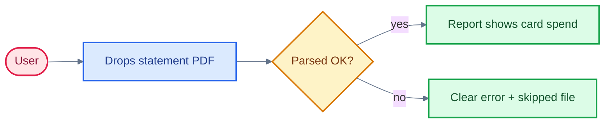
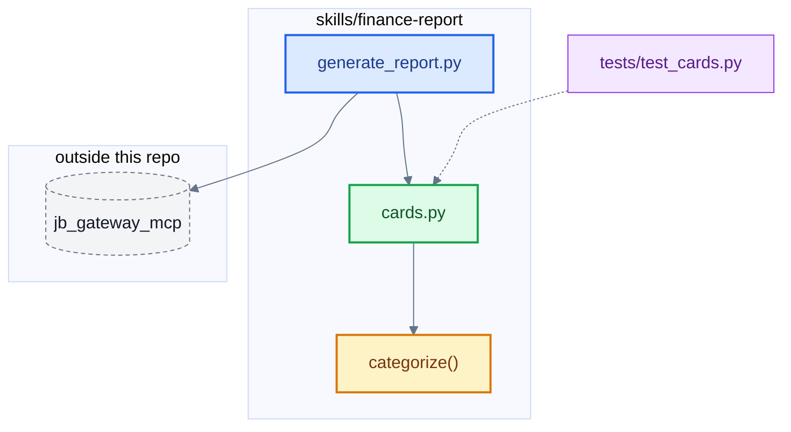
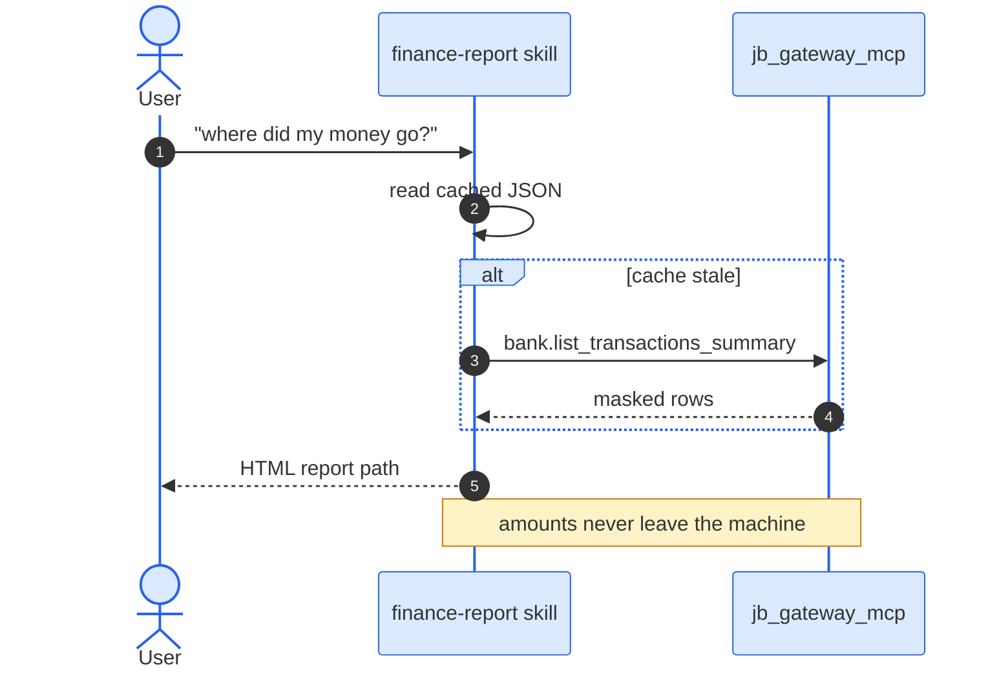
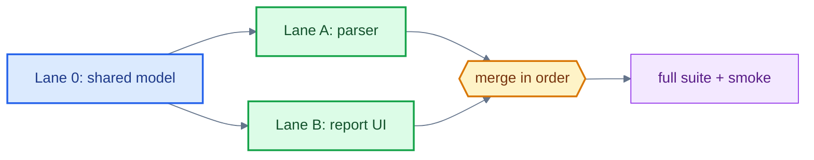
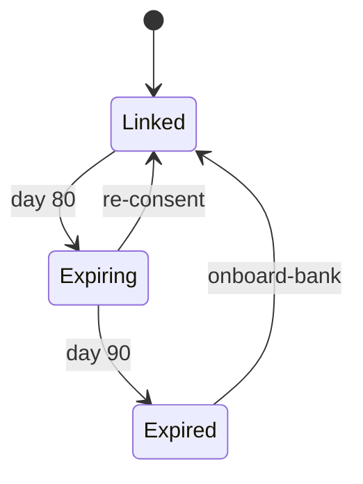
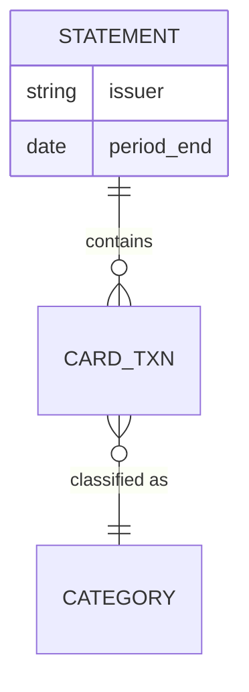

# Diagram style guide (spec.md / plan.md)

Diagrams are Mermaid fenced blocks. GitHub, the PR view and VS Code (with
the *Markdown Preview Mermaid Support* extension) render them natively.
A diagram **replaces** prose — don't describe in text what the diagram shows.

## Which diagram, where

| Doc | Diagram | Type | When |
|---|---|---|---|
| spec.md (full) | **User flow** — what the user does and sees, happy path + error branch | `flowchart LR` | always on full track |
| spec.md (full) | **States** — lifecycle of the thing being changed | `stateDiagram-v2` | feature has states (consent, sync, import) |
| plan.md | **Change map** — modules/files touched, classed new / changed / external, with data flow | `flowchart TD` + `subgraph` per area | full track, or ≥3 files |
| plan.md | **Interaction** — calls across process/API/MCP/hook boundaries | `sequenceDiagram` | the change crosses a boundary |
| plan.md | **Schema** — tables/entities changed | `erDiagram` | data model or migration |
| plan.md | **Build lanes** — lane 0 → parallel lanes → merge → verify | `flowchart LR` | plan defines lanes |

Limits: **1–2 diagrams per doc, ≤ 15 nodes each**, labels ≤ 5 words, real
file/function names from the scout map — no invented components.

## House style

Start every diagram with the init line, and class every node — colour carries
meaning, so a reader sees *what's new vs. touched vs. external* at a glance.
Light fills + dark text read well on both GitHub light and dark themes.

```text
%%{init: {"theme": "base", "themeVariables": {"fontFamily": "ui-sans-serif, system-ui", "fontSize": "14px", "lineColor": "#64748B", "primaryColor": "#EEF2FF", "primaryBorderColor": "#6366F1", "primaryTextColor": "#1E1B4B"}}}%%
classDef new      fill:#DCFCE7,stroke:#16A34A,color:#14532D,stroke-width:2px
classDef changed  fill:#DBEAFE,stroke:#2563EB,color:#1E3A8A,stroke-width:2px
classDef external fill:#F3F4F6,stroke:#6B7280,color:#111827,stroke-dasharray:4 3
classDef risk     fill:#FEF3C7,stroke:#D97706,color:#78350F,stroke-width:2px
classDef test     fill:#F3E8FF,stroke:#9333EA,color:#581C87
classDef actor    fill:#FFE4E6,stroke:#E11D48,color:#881337,stroke-width:2px
```

| Class | Meaning |
|---|---|
| `new` (green) | file/component created by this change |
| `changed` (blue) | existing code modified |
| `external` (grey, dashed) | untouched dependency, API, MCP server, OS |
| `risk` (amber) | where the plan's risks live — money math, auth, migration |
| `test` (purple) | test files; link to the code they cover with `-.->` |
| `actor` (rose) | the user or another system starting the flow |

Syntax rules (the linter enforces them — `sdlc.py check-diagrams`):
- Quote any label containing `( ) [ ] { } " |`: `A["parse(statement)"]`.
- Never use `end` as a node id; every `subgraph` and every `alt/opt/loop/par` block closes with `end`.
- Every `:::class` / `class X name` must have a `classDef`.

## Templates

### User flow (spec)



### Change map (plan)



### Interaction (plan)



### Build lanes (plan)



### States (spec) and schema (plan)




